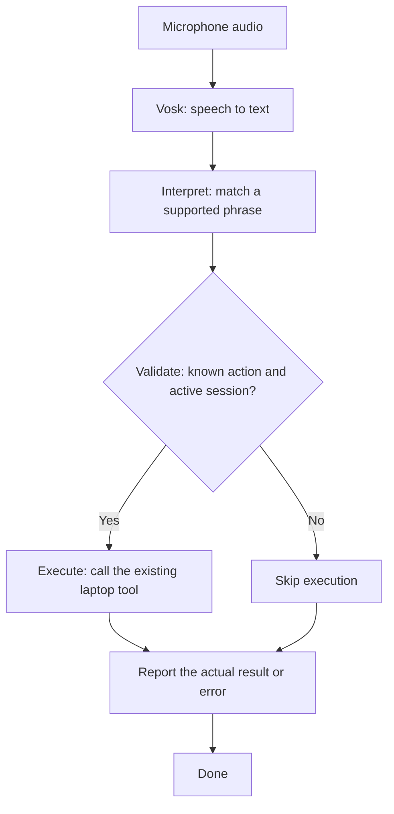

# Laptop voice agent — local voice test

## Repository publication status

This repository currently contains the setup and documentation milestone for a
voice-controlled Windows desktop assistant. The working application source is
being published incrementally and is not included in this first milestone.
The usage instructions below describe the local prototype; they will become
runnable from a fresh clone once the source and launchers are published.
The repository URL is named `troubleshooting`; its current project is the
voice-controlled desktop assistant described here.

Current stage: offline voice recognition connected to fixed laptop actions through LangGraph. No language model, AI planning, or arbitrary terminal commands.

## LangGraph workflow

Speech is converted to text by Vosk before entering the graph:



Each graph node is a Python function. The graph state carries the text, matched action, permission result, tool result, and stop request. The app prints each completed node beneath your transcript. It does not retry launches or store state across restarts. Launch requests are not proof that a window opened. LangGraph organizes the workflow; the existing exact matcher still interprets commands. A language model can be added later.

Double-click **Show Workflow Demo.cmd** to see real graph runs for a supported command, an unsupported command, and Stop. The demo simulates execution; it never opens applications or records audio.

Run checks with `.\.venv\Scripts\python.exe -m unittest discover -v`.

## Try your voice

Double-click **Start Voice Agent.cmd** in this folder. Close the previous test window first if it is still open.

1. Choose your microphone. Your headset is selected if Windows uses it as the default.
2. Press **Start listening**, then wait for “Listening — speak now.”
3. Say “computer open Notepad.” Pause briefly to finish the sentence and trigger the action.
4. Watch live words appear above the completed transcript.
5. Press **Stop** to release the microphone. You can start again or clear the transcript.

No audio or transcript files are saved. Nothing is sent to a cloud service. Recognition is English-only for now. If there is no input, select the laptop microphone, check Windows microphone access for desktop apps, and try again. Connect the microphone before starting the application; restart the application if a newly connected device is not listed.

## Supported commands

- “computer open Chrome”
- “computer open Visual Studio Code” (opens this project)
- “computer open Notepad”
- “computer open Calculator”
- “computer open project folder”
- “computer stop listening”

Speak the complete phrase in one utterance, then pause. Other speech is transcribed but does not execute. Repeated identical actions within three seconds are ignored. Chrome and VS Code must be installed in a standard location. A launch request means Windows accepted the request; it does not verify the application's window appeared. Stop and Close prevent subsequent queued transcripts from running actions. Speech recognition can make mistakes; this is not speaker authentication.

## Installed components

- `.venv`: isolated Python environment for this project.
- `vosk`: offline speech recognition engine.
- `sounddevice`: microphone access.
- `models/vosk-model-small-en-us-0.15`: English recognition model from https://alphacephei.com/vosk/models.

After installation, speech recognition can run locally without an API key or cloud server. Audio recognition quality still needs testing with your voice and microphone.

## Check setup

From PowerShell in this folder:

```powershell
.\.venv\Scripts\python.exe check_setup.py
```

This loads the model, processes synthetic silence, and checks input-device availability. It does not record the microphone or execute voice commands.

## Next stages

1. Test recognition with your voice and chosen microphone.
2. Test the supported commands with your microphone.
3. Add Firebase and phone access later.

No Firebase credentials or cloud services are needed for the current stage.
